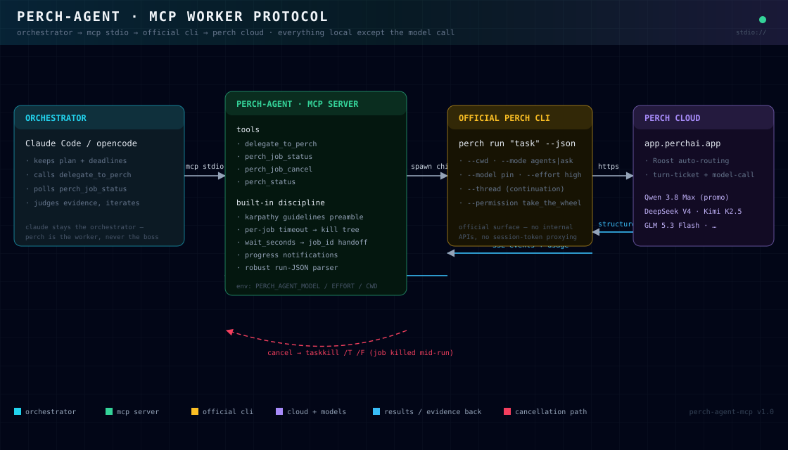

<div align="center">

# ⚡ perch-agent

**Delegate tasks from Claude Code / opencode to Perch AI as an autonomous worker agent.**

One MCP server. Your orchestrator keeps the plan — Perch does the work, verifies it, and comes back with evidence.

[](https://nodejs.org)
[](https://modelcontextprotocol.io)
[](LICENSE)
[](#-testing)
[](#-benchmarks)

[Architecture](#-architecture) · [Quick Start](#-quick-start) · [Tools](#%EF%B8%8F-tools) · [Benchmarks](#-benchmarks) · [Troubleshooting](#-troubleshooting)

</div>

---

## 🏗 Architecture



Claude Code (or opencode) stays the **orchestrator**. This server translates one MCP tool call into the
**official** `perch` CLI (`perch run "<task>" --json`) — no unofficial internal APIs, no session-token
proxying — and returns a structured result: final answer, thread id, model identity and token usage.

## ✨ Features

- 🔁 **Async job model** — long tasks return a `job_id` in seconds; poll `perch_job_status` or cancel
  with `perch_job_cancel` (kills the whole process tree).
- 🧭 **Karpathy guidelines baked in** — every delegated task is prepended with working discipline:
  surface assumptions, minimal change, surgical scope, verification with real command output.
  (`guidelines: false` to disable.)
- 📊 **Live progress** — `notifications/progress` every 5s while a task runs; renders in Claude Code.
- 🧵 **Thread continuation** — pass a previous `thread_id` and the worker remembers the conversation.
- 🎯 **Model pinning** — tier (`standard`/`pro`) or pin id (`qwen-3.8-max`, `glm-5.3-flash-starter`, …).
- 🧾 **Evidence-first output** — `assistant_text`, `model_id`, `usage`, `thread_id`, exit codes, and
  human-readable plan-gate errors instead of raw stack traces.
- 🔒 **Local-first** — everything runs on your machine; the only network hop is the official CLI →
  Perch's own API, using your existing login. No keys to manage.
- 🧪 **Battle-tested** — unit + E2E suite, plus a real benchmark harness (Exercism polyglot, agentic
  coding, differential reasoning) included in [`bench/`](bench/).

## 🚀 Quick Start (3 Steps)

### Step 1 — Prerequisites

- **Node.js 20+**
- **Perch CLI installed and logged in** (the MCP reuses this session — no API key):

```powershell
npm i -g perchai-cli
perch login          # browser sign-in (Google/GitHub)
perch status         # must show "Signed in as …"
```

### Step 2 — Get this repo

```bash
git clone https://github.com/DMCconnect/perch-agent-mcp.git
cd perch-agent-mcp
npm install
npm test             # parser self-check
```

### Step 3 — Register with your harness

**Claude Code** (user scope):

```bash
claude mcp add --scope user perch-agent \
  -e PERCH_AGENT_MODEL=qwen-3.8-max \
  -e PERCH_AGENT_EFFORT=high \
  -- node "C:/path/to/perch-agent-mcp/index.js"

claude mcp list      # → perch-agent: ✓ connected
```

> For long delegations also set `MCP_TOOL_TIMEOUT=900000` in your environment
> (Claude Code's default MCP call timeout is short).

**opencode** (`~/.config/opencode/opencode.json`):

```json
{
  "mcp": {
    "perch-agent": {
      "type": "local",
      "command": ["node", "C:/path/to/perch-agent-mcp/index.js"],
      "enabled": true,
      "timeout": 1200000
    }
  }
}
```

**Codex CLI** (`~/.codex/config.toml`):

```toml
[mcp_servers.perch-agent]
command = "node"
args = ['C:/path/to/perch-agent-mcp/index.js']
startup_timeout_sec = 120
tool_timeout_sec = 1200

[mcp_servers.perch-agent.env]
PERCH_AGENT_MODEL = "qwen-3.8-max"
PERCH_AGENT_EFFORT = "high"
```

**Any other MCP client** — it's a plain stdio server:

```
command: node <path>/index.js
```

Done. In your harness, say: *"Use perch-agent to fix the failing tests in ./app"*.

## 🛠️ Tools

| Tool | What it does |
|---|---|
| `delegate_to_perch` | Spawn a Perch worker run. Params: `task` (required), `cwd`, `mode` (`ask`/`agents`/`plan`), `model`, `effort`, `persona`, `thread_id`, `guidelines`, `permission`, `wait_seconds` (default 120), `timeout_seconds` (default 1800). Finishes inline, or returns `{status:"running", job_id}` for async handoff. |
| `perch_job_status` | Live status/result of a job: state, elapsed, `assistant_text`, `model_id`, `usage`, errors with hints. |
| `perch_job_cancel` | Kill a running job's whole process tree (`taskkill /T /F`). |
| `perch_status` | Free local check: CLI version, sign-in state, live job list. |

**Result shape (success):**

```json
{
  "job_id": "pj-95c583b8",
  "status": "finished",
  "perch_status": "completed",
  "ok": true,
  "thread_id": "cli-cwd-a713c141ff2d4ddb",
  "assistant_text": "…final worker answer…",
  "model_id": "Qwen/Qwen3.8-Max",
  "usage": { "input_tokens": 15761, "output_tokens": 30, "total_tokens": 24495 }
}
```

## 🎛️ Environment

| Variable | Default | Purpose |
|---|---|---|
| `PERCH_AGENT_MODEL` | `standard` | Default model pin for every delegation. |
| `PERCH_AGENT_EFFORT` | `high` | Default reasoning effort. |
| `PERCH_AGENT_DEFAULT_CWD` | OS temp dir | Fallback `cwd` when the caller omits one. |
| `PERCH_AGENT_CLI` | auto-resolve | Explicit path to the CLI's JS entry (see Troubleshooting #1). |

### 🔥 The free Qwen 3.8 Max pin

**Qwen 3.8 Max is free on the Perch Starter plan until Nov 20, 2026**
([announcement](https://www.perchai.app/announcements)). To make it the default worker:

```
PERCH_AGENT_MODEL=qwen-3.8-max   PERCH_AGENT_EFFORT=high
```

After the promo expires, the CLI rejects the pin with a clear plan error — switch back to
`standard` (or any current Starter pin) with one env change.

## 🧠 The karpathy preamble

Every `delegate_to_perch` task ships with this discipline header (the whole point of a *worker* —
it must not wander, and it must prove it finished):

```
1. Think before coding — state your assumptions explicitly…
2. Simplicity first — the minimum change that solves the problem…
3. Surgical changes — touch only what the task requires…
4. Goal-driven verification — run the tests/builds, quote the real command
   and its output as evidence. Never claim verification without evidence.
```

Disable per-call with `guidelines: false`.

## 📈 Benchmarks

Real runs by this repo's harness against the live Perch service (Starter plan), graded
**objectively** — pytest/exit-codes/answer-checking, never the model's self-report:

| Suite | Items | standard (Qwen 3.6-35B) | qwen-3.8-max |
|---|---|---|---|
| Math / logic / JS-reasoning | 16 | 16/16 | 16/16 |
| Exercism polyglot (pytest-graded) | 3 exercises | ✅ bowling·rectangles·zebra (84–126s) | ✅ all (127–153s) |
| Agentic coding (build / debug-tests / stateful CLI) | 3 | ✅ 3/3 | ✅ 3/3 (agentic run **2.5× faster**) |
| Mid-run cancellation | — | ✅ clean kill | ✅ clean kill |

> **Is the pinned model real?** Perch's own accounting reports `Qwen/Qwen3.8-Max` per turn and the
> timing fingerprint differs from `standard` per task type — while short-form reasoning scores are
> tied. Harness: [`bench/`](bench/) · methodology borrowed from
> [aider's polyglot benchmark](https://aider.chat/docs/leaderboards/) (Exercism + pytest, self-correction loop).

## 🧪 Testing

```bash
npm test              # parser hardening self-check
npm run e2e           # full MCP E2E: happy path, threads, error surfacing, async+cancel
npm run bench:polyglot  # Exercism exercises, pytest-graded (needs: python + pytest)
```

The E2E covers: inline completion, thread continuation, plan-gate error surfacing,
async `job_id` handoff, and mid-run cancellation.

## 🔧 Troubleshooting

| Symptom | Cause / fix |
|---|---|
| `spawn EINVAL` | Node ≥ 20.12 refuses `.cmd` shims. This repo already resolves the shim to the real JS entry — if you set `PERCH_AGENT_CLI`, point it at the `.js`, not the `.cmd`. |
| `MCP error -32001: Request timed out` | Harness-side timeout. Claude Code: set `MCP_TOOL_TIMEOUT=900000`. opencode: set `"timeout": 1200000` in the MCP config (this README's snippet already does). |
| `perch_surface_required` / plan errors | Your plan doesn't cover that surface or model pin. The CLI's plan-gate message is surfaced verbatim in `error`. |
| Status says "not signed in" but runs work | Stale access token — `perch_status` reports it before refresh; actual runs refresh lazily and succeed. Cosmetic. |
| Worker asks instead of writing files | Don't override `permission` — the default `take_the_wheel` is required for autonomous delegation. |
| Headless `claude -p` flagged `[cyber]` | The 5.5-model safeguard classifies **project context**, not just prompts — aggressive `AGENTS.md` content trips it for *any* MCP (verified with an independent control). Run `-p` from a neutral directory, or use interactive sessions. |

## 🤖 For agents (machine-readable)

- [`llms.txt`](llms.txt) — condensed install + tool contract for LLM agents.
- Tool schemas are standard MCP (`tools/list`); this server speaks plain stdio JSON-RPC.
- Safe to auto-install: no telemetry, no keys, no network beyond the official CLI → Perch.

## 📄 License

[MIT](LICENSE) — free to use, modify, and share.

## 🙏 Credits

- Discipline header from the **[karpathy-guidelines](https://github.com/anthropics/skills)** pattern.
- Benchmark methodology from **[aider's polyglot benchmark](https://github.com/Aider-AI/aider/tree/main/benchmark)** (Exercism + pytest).
- Diagram style inspired by **[Cocoon-AI/architecture-diagram-generator](https://github.com/Cocoon-AI/architecture-diagram-generator)**.
- Reliability patterns studied from **glm-mcp** and **opencode-mcp**.

---

<div align="center">
<sub>Built by GLM (orchestrator) + Perch Qwen 3.8 Max (worker) — the tool dogfooded itself.</sub>
</div>
